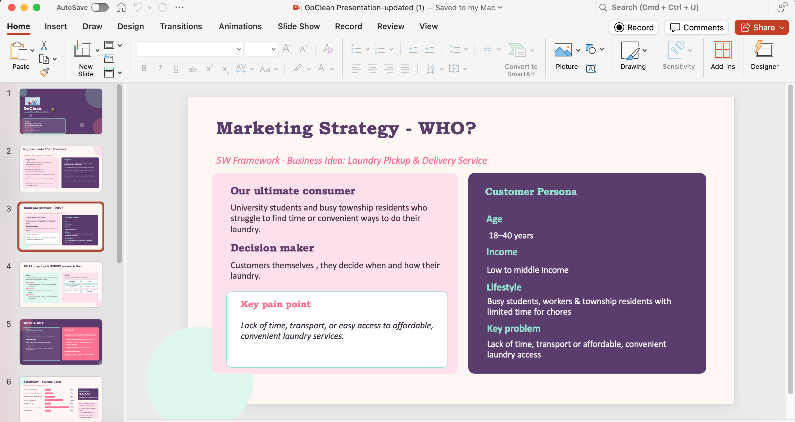

# GoClean Agile Project Portfolio

Welcome to our GoClean Agile Project Portfolio. This portfolio presents our team's project journey, completed application, Agile practices, supporting evidence and reflections on what we learned throughout the project.

GoClean is a laundry pickup and delivery application designed for university students and busy township residents. It provides a convenient way for customers to explore laundry services and arrange laundry collection and delivery.

Our team initially considered a digital public healthcare clinic appointment and patient management system. After considering lecturer feedback about feasibility and complexity, we changed our project direction to GoClean and focused on a practical laundry service solution.

## Project Overview

- **Project name:** GoClean
- **Project type:** Laundry pickup and delivery application
- **Target customers:** University students and busy township residents
- **Project objective:** To develop GoClean while applying Agile principles and practices to project planning, task organisation, teamwork and reflection.
- **Project management tool:** Trello
- **Application evidence:** GoClean interface screenshots, wireframes and Trello task records

## Project Vision

Our vision is to make laundry services more convenient for students and busy residents by providing a digital experience that supports service selection and laundry pickup and delivery.

## Target Market

GoClean is designed for university students and busy township residents who want a convenient way to manage their laundry alongside their studies, work and daily responsibilities.

## Application Design

The GoClean wireframes illustrate the key screens and customer journey, including Welcome, Login, Home, Order, History and Track Order. These designs supported the organisation of the application and helped connect customer needs with the features presented in the project.

## Assessment Sections

This portfolio contains the five sections required for the Agile project assessment.

### 1. Agile Team Charter

Presents the project vision, objectives, team members, scope, communication and collaboration practices, challenges, lessons learned and personal reflection.

[Open the Agile Team Charter](agile-team-charter.md)

### 2. User Stories and Tasks

Presents customer-focused user stories, their associated tasks and acceptance criteria, connecting customer needs with the GoClean application.

[Open User Stories and Tasks](user-stories-and-tasks.md)

### 3. Product Backlog

Organises GoClean features and requirements by priority and sprint grouping, showing how the team structured the work around the customer journey.

[Open the Product Backlog](product-backlog.md)

### 4. Sprint Backlog

Documents sprint goals, task organisation and progress evidence, demonstrating how Trello supported the team's Agile workflow.

[Open the Sprint Backlog](sprint-backlog.md)

### 5. Agile Logbook

Records the project timeline, important decisions, planning activities, challenges, supporting evidence and reflections on the team's learning.

[Open the Agile Logbook](agile-logbook.md)

## Project Evidence

Our Trello board provides evidence of the product backlog, sprint organisation and task checklists. It demonstrates how the team organised work, assigned responsibilities and tracked progress throughout the project.

### Example of Task-Level Progress

The Login Page card contains five subtasks and shows 100% completion on its checklist. This provides evidence of task-level progress and the team's use of Trello to organise and monitor project work.

## Team Members

- Thandeka Chantal Malande
- Oratilwe Catherine Komane
- Solomon Elias Machaule
- Nomhle Njengele
- Lerato Nadine Letsoele

## Conclusion

The GoClean project brought together application development, Agile planning, teamwork and reflection. This portfolio connects the project artefacts with the decisions our team made, the progress recorded in Trello and the lessons we gained from applying Agile practices to a team project.

---

*GoClean Agile Project Portfolio.*
