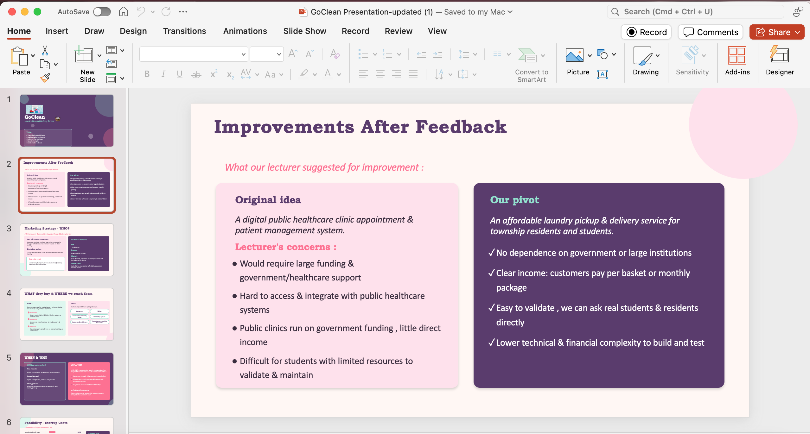
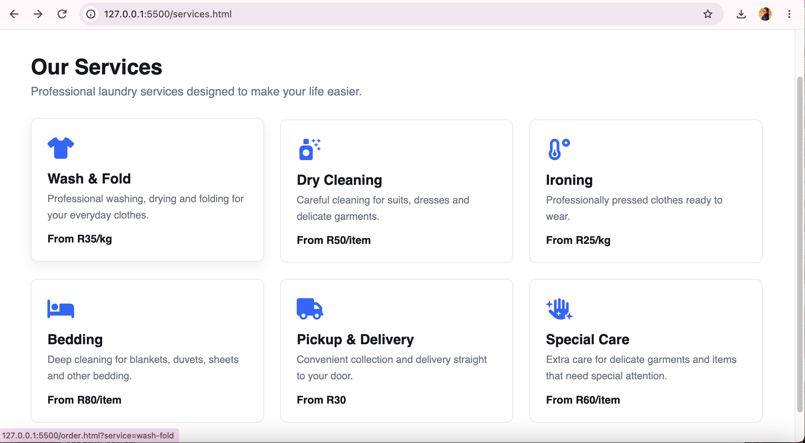

# GoClean Agile Logbook

## 1. Introduction

An Agile logbook records important project activities, decisions, progress and lessons learned throughout the software development process. It provides a chronological account of how a team develops its project idea, responds to feedback, organises requirements, manages tasks and evaluates its work.

The GoClean project focused on developing a laundry pickup and delivery application designed to provide convenient and affordable laundry services to university students and busy residents. The project journey included exploring an initial concept, reviewing its feasibility, responding to lecturer feedback, identifying target customers, organising application features, developing the application, testing the completed solution and preparing the supporting portfolio documentation.

This logbook documents the key stages of the GoClean project and reflects on my learning in feasibility analysis, teamwork, prioritisation, product backlog management, sprint organisation, testing and project documentation. It also connects the activities recorded throughout the project with evidence from the Trello board and the completed application's interfaces.

## 2. Project Activity Log

The following table presents the main project activities in chronological order, together with a description of the work and the knowledge gained from each stage.

| Date | Project activity | Description of activity | Reflection and learning |
|---|---|---|---|
| 16 July 2026 | Initial project idea | The team explored a digital public healthcare clinic appointment and patient management system. | This introduced me to identifying a community need and translating it into a software project idea. |
| 23 July 2026 | Reviewing the initial idea | The team considered the scope, complexity and feasibility of the healthcare concept. | I learned that project planning involves balancing the value of an idea with the team's available time, skills and resources. |
| 30 July 2026 | Project pivot to GoClean | Following lecturer feedback, the team changed direction and developed the GoClean laundry pickup and delivery concept. | This taught me the importance of constructive feedback, adaptability and making informed decisions when refining a project. |
| 2 August 2026 | Login Page backlog activity | The Login Page card was added to the Trello product backlog. Its checklist records five completed subtasks. | I learned how breaking a feature into smaller activities makes task organisation and progress tracking more manageable. |
| 10 August 2026 | Identifying target customers | The project focused on university students and busy township residents who could benefit from convenient laundry services. | Identifying the target market helped connect the application to a specific audience and its service needs. |
| 20 August 2026 | Planning the customer journey | Application screens included Welcome, Login, Home, Order, History and Track Order. | Wireframes helped communicate the user journey and organise the application's interface before development. |
| 5 September 2026 | Organising the product backlog | Features such as registration, login, laundry booking, order tracking and account management were organised using Trello. | I learned how a product backlog breaks a large project into individual features and helps the team organise priorities. |
| 20 September 2026 | Organising sprint work | Features were grouped into sprint lists on the Trello board, including Sprint 1, Sprint 2 and Sprint 3. | Sprint grouping helped structure related features and made the work associated with the customer journey easier to understand. |
| 8 October 2026 | Reviewing project requirements and evidence | Project artefacts and the Trello board were reviewed while preparing the Agile e-portfolio. | I learned the importance of connecting project decisions and activities with relevant supporting evidence. |
| 15 October 2026 | Preparing portfolio documentation | The Agile Team Charter and User Stories and Tasks sections were prepared for the e-portfolio. | Documenting these artefacts helped me connect the project's vision, target customers and functionality. |
| 20 October 2026 | Documenting the product backlog | The Product Backlog section was prepared using the GoClean features and their organisation on Trello. | I developed a stronger understanding of feature prioritisation and the relationship between customer needs and product requirements. |
| 22 October 2026 | Documenting the sprint backlog | The Sprint Backlog section was prepared around selected sprint groupings and recorded task evidence. | I learned how sprint goals, task cards and checklists help organise work and communicate recorded progress. |
| 23 October 2026 | Preparing the Agile Logbook | This logbook was prepared to bring together the project timeline, reflections, lessons learned and supporting evidence. | Reflecting on the project helped me recognise how Agile planning, teamwork and documentation contributed to the completed project. |

The timeline demonstrates the progression from selecting a project concept to organising requirements, developing the application, testing the completed solution and documenting the work. It also shows how the project artefacts provide a record of the team's planning and learning throughout the development process.

## 3. Meetings and Team Communication

Communication played an important role in organising the GoClean project. Team collaboration involved considering the project's direction, discussing its features, responding to feedback and arranging tasks around the application's main customer journey.

The decision to move from the initial healthcare concept to GoClean illustrates the importance of communication when evaluating a project's direction. Lecturer feedback encouraged the team to reconsider the original idea and identify a more suitable concept for the project. This decision helped establish a clearer focus on laundry pickup and delivery services for the intended target market.

Trello provided a shared workspace where the team could organise product backlog items, group related work into sprint lists, assign team members to task cards and record checklist progress. This visual approach made project activities easier to review and supported coordination among team members.

The Login Page and Order Page (Booking) cards provide examples of how task information was organised. Both cards show five completed subtasks, while the booking card records 100% checklist progress and displays assigned team members. These records demonstrate how Trello supported task breakdown, responsibility allocation and progress visibility.

Effective communication and documentation practices include:

- Recording meeting dates and the team members who attended.
- Documenting the main topics discussed.
- Keeping a record of significant decisions and the reasons behind them.
- Assigning responsibilities to individual tasks.
- Sharing progress updates with team members.
- Recording relevant changes and their reasons.
- Keeping task information organised in Trello.
- Reviewing completed work against the project's objectives.

These practices support accountability, collaboration and a shared understanding of project objectives. The project also taught me that clear communication helps team members understand how individual responsibilities contribute to the overall application.

## 4. Challenges and Lessons Learned

One of the key challenges during the GoClean project was selecting a concept with a suitable scope. The original idea focused on a digital healthcare clinic appointment and patient management system. After receiving lecturer feedback, the team reconsidered the initial direction and developed the laundry pickup and delivery concept.

This experience taught me that feedback is an important part of Agile development. Rather than treating a change in direction as a setback, I learned to view it as an opportunity to reassess the project's suitability and strengthen its focus. The decision to develop GoClean helped the team concentrate on a service with an identifiable target audience and a clear practical purpose.

Another important lesson was the value of breaking a project into manageable features and tasks. A software application involves several connected activities, and organising them into individual backlog items makes the work easier to understand and manage. The product backlog helped structure the application's functionality, while sprint groupings brought related features together.

Trello task cards and checklists also demonstrated the importance of recording progress. The completed Login Page and Order Page (Booking) checklists illustrate how larger features can be divided into smaller activities and monitored through a shared workspace. This helped me understand why visible task records are useful when coordinating work in a group project.

The project strengthened my understanding of prioritisation. Features such as customer registration, login and laundry booking support the central customer journey, while features such as notifications, payment functionality and profile management contribute to the wider service experience. Organising these requirements helped demonstrate the relationship between individual features and the overall purpose of GoClean.

Testing the completed GoClean application helped me appreciate the relationship between planned requirements and the finished solution. Reviewing the application alongside the project artefacts provided a clearer understanding of how requirements, interface design, development activities and testing contribute to a functioning application.

Finally, preparing the portfolio reinforced the importance of documentation and evidence. Interface screenshots demonstrate the application's design, while Trello boards and task cards provide records of how the team organised its work. Together, these artefacts help communicate the development process and support reflection on the decisions made throughout the project.

## 5. Personal Reflection

Preparing this logbook helped me understand that Agile development involves more than dividing a project into sprints. It also requires a team to respond to feedback, organise requirements, prioritise work, communicate responsibilities and evaluate the outcomes of its activities.

The decision to move from the healthcare concept to GoClean taught me that adaptability is an important part of teamwork. I learned to consider feedback carefully and recognise how reassessing an initial idea can help a team establish a clearer project direction. This experience also highlighted the importance of feasibility when selecting a project that can be developed within the available time and resources.

Working with the product backlog improved my understanding of how a broad project idea can be divided into individual features. I learned that prioritisation helps a team identify the functionality that supports the main customer journey, while sprint groupings help organise related areas of work. These practices provided a clearer structure for understanding the different parts of the GoClean application.

Using Trello strengthened my understanding of task organisation and shared responsibility. The Login Page and Order Page (Booking) cards demonstrated how checklists can divide activities into smaller tasks and record their completion. Seeing team assignments and checklist progress also helped me appreciate the value of maintaining a shared record of project work.

Completing and testing GoClean allowed me to connect the planning activities with the finished application. I gained a better understanding of how customer requirements, interface design, feature organisation and testing contribute to the overall development process. The completed application also gave practical meaning to the requirements and planning activities documented throughout the project.

I also learned that evidence is an important part of explaining software development work. Interface screenshots show the application that was developed, while Trello cards and checklists demonstrate how project activities were organised and recorded. Bringing these materials together helped me explain both the team's work and my own learning.

Overall, this project strengthened my understanding of Agile planning, feasibility, prioritisation, teamwork and project documentation. It improved my ability to reflect on project decisions and explain how individual activities contributed to the completed GoClean application. These skills will be valuable when participating in future software development projects because they encourage structured planning, effective collaboration and clear communication.

## 6. Supporting Evidence

The following evidence connects the project's decisions, task-management activities and completed application interfaces with the reflections presented in this logbook.

### Evidence 1: Lecturer Feedback and Project Pivot

The image below shows the initial healthcare project idea and the feedback that informed the team's decision to develop GoClean.

This evidence supports my reflection on project feasibility, constructive feedback and adapting the project's direction. It illustrates how reviewing an initial concept helped the team establish a clearer focus for the completed project.

### Evidence 2: Trello Activity and Task Progress

The GoClean Trello board provides an overview of how the team organised features, product backlog items, sprint lists and task cards.

The Login Page card records activity on 2 August 2026, and its checklist shows five completed subtasks. The Order Page (Booking) card also records five completed subtasks and 100% checklist progress, alongside the assigned team members.

These records demonstrate task breakdown, responsibility allocation and recorded progress. They also show how Trello provided a shared reference point for organising and reviewing project activities.

The GoClean Trello board can also be accessed here: [View the GoClean Trello Board](https://trello.com/b/Ia2c4Am0/goclean-app).

### Evidence 3: Completed Application Interfaces

The following screenshots provide visual evidence of the completed GoClean application's interface and service information.

**Login Interface**

The login interface demonstrates the design of the customer access screen and complements the Login Page task evidence recorded in Trello.

**Services Interface**

The services interface demonstrates how GoClean presents its laundry service offerings to customers. It connects the application's interface with the project's objective of providing convenient access to laundry pickup and delivery services.

Together, these screenshots demonstrate the completed application's interface and complement the planning, task-management and project-decision evidence presented above.

## 7. Conclusion

The GoClean project provided an opportunity to apply Agile principles to a practical service concept. From exploring the initial idea and responding to lecturer feedback to organising product requirements, grouping features into sprints, developing the application and testing the completed solution, the project strengthened my understanding of the software development process.

The most important lessons I gained were the value of realistic project planning, adaptability, clear communication, prioritised tasks and organised documentation. Working with Trello helped me understand how backlog items, sprint groupings, task assignments and checklists contribute to shared visibility and collaboration.

The completed and tested GoClean application connected these planning activities with a functional digital solution. The supporting evidence demonstrates the relationship between the team's decisions, its recorded task progress and the application interfaces.

Overall, GoClean was a valuable learning experience that strengthened my understanding of Agile teamwork, project organisation and software delivery. Preparing this logbook also helped me recognise the importance of reflecting on project decisions and using evidence to explain both the development process and the skills gained.
