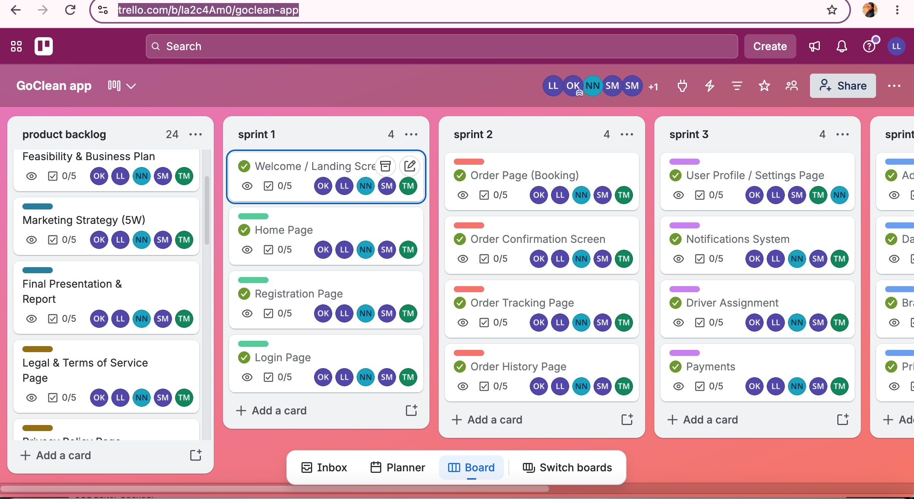
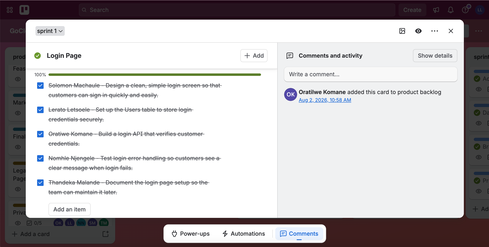
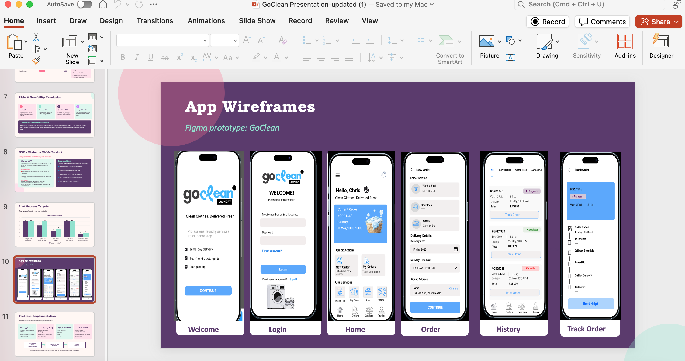

# GoClean — Agile Logbook

## 1. Introduction

An Agile logbook records important project activities, decisions, progress, challenges and reflections throughout a project. It helps team members review what happened, identify lessons learned and decide what needs to happen next.

For GoClean, this logbook records the project's development, from the initial idea to the planning and documentation of the proposed laundry pickup and delivery service. It includes reflections on how feedback, teamwork, backlog organisation and sprint planning contributed to the project.

## 2. Project Activity Log

| Date | Project activity | What happened | Reflection and next action |
|---|---|---|---|
| 16 July 2026 | Initial project idea | Our team explored a digital public healthcare clinic appointment and patient management system. | This helped us identify a possible community need. We also needed to consider the project's complexity and our available resources. |
| 23 July 2026 | Reviewing the initial idea | The team considered the scope and feasibility of the healthcare concept. | I learned that an idea must be realistic and achievable within the team's time, skills and resources. |
| 30 July 2026 | Project pivot to GoClean | Following lecturer feedback, the team changed direction to a proposed affordable laundry pickup and delivery service. | This showed me the importance of responding to feedback and adapting a project when the original idea may be too complex. |
| 2 August 2026 | Login Page backlog activity | Trello activity records the Login Page card being added to the product backlog. The card checklist shows five completed subtasks. | Breaking a feature into smaller tasks makes progress easier to monitor. The checklist is evidence for this card, not the entire application. |
| 10 August 2026 | Defining the target customers | The GoClean concept focused on students and busy township residents who may benefit from convenient laundry collection and delivery. | Identifying the target market helped us connect the proposed service to customer needs. |
| 20 August 2026 | Planning the customer journey | The proposed application screens included Welcome, Login, Home, Order, History and Track Order. | Wireframes helped us communicate how customers might navigate the service before implementation. |
| 5 September 2026 | Organising the product backlog | The team used Trello to organise proposed features, including registration, login, ordering, tracking and account management. | A visible backlog helps the team understand the work required and consider feature priorities. |
| 20 September 2026 | Organising sprint work | The Trello board grouped features into Sprint 1, Sprint 2 and Sprint 3. | Dividing the work into stages makes the project easier to organise. Sprint lists should be reviewed as requirements and progress change. |
| 8 October 2026 | Reviewing project requirements and evidence | The project artefacts and Trello board were reviewed to support the documentation of the Agile process. | I learned that portfolio evidence should show the actual work and distinguish completed tasks from planned features. |
| 15 October 2026 | Developing portfolio documentation | The Agile Team Charter and User Stories and Tasks sections were prepared for the e-portfolio. | Documenting these artefacts helped connect the team's plans with the purpose and needs of the GoClean project. |
| 20 October 2026 | Documenting the product backlog | The Product Backlog section was prepared using the proposed features and the organisation visible on Trello. | Prioritising features helps the team focus on the main customer journey while recognising supporting requirements. |
| 22 October 2026 | Documenting the sprint backlog | The Sprint Backlog section was prepared around the three sprint lists and the available task evidence. | I learned that a feature appearing in a sprint does not automatically mean it has been completed. Progress needs supporting evidence. |
| 23 October 2026 | Completing the Agile Logbook | The Agile Logbook was prepared to record the project's direction, planning activities, evidence and lessons learned. | The logbook brings the project journey together. Going forward, the team should record actual meeting dates, decisions, responsibilities and progress more consistently. |

**Timeline note:** This timeline summarises the project journey. The Login Page activity on 2 August 2026 is supported by the available Trello activity evidence. The other dates are used to organise the project activities chronologically and are not independently verified meeting dates or completion dates.

## 3. Meetings and Team Communication

Our team used formal and informal meetings to discuss the project and its direction. These discussions supported communication and decision-making as the GoClean concept developed.

A complete record of meeting dates, attendance and detailed minutes was not available when this logbook was prepared. Therefore, specific meeting dates and daily stand-ups are not presented as confirmed events.

For future project work, the team should record the date of each meeting, who participated, the topics discussed, decisions made, assigned tasks and any issues requiring follow-up. This would make progress easier to track and provide stronger evidence of the Agile process.

## 4. Challenges and Lessons Learned

One challenge was selecting a project idea that could be developed within the team's available time and resources. The change from the healthcare concept to GoClean demonstrates the importance of reviewing scope and responding to feedback.

Another lesson was the importance of breaking work into manageable features and tasks. The Trello board helps the team see how features are grouped into sprints, while individual card checklists provide a way to track task-level progress.

I have also learned that good Agile documentation should reflect what actually happened. Planned work, completed tasks, decisions and lessons learned should be clearly distinguished so that the logbook remains a reliable project record.

## 5. Personal Reflection

Preparing this logbook has helped me understand that Agile is not only about dividing development into sprints. It also involves communication, adapting to feedback, recording decisions and reflecting on progress.

The GoClean project pivot showed me that a team may need to reconsider its original idea when feedback or practical constraints reveal that a different direction is more achievable. The backlog and sprint lists then help organise the revised project scope into smaller features.

I would improve our process by recording meeting dates and outcomes more consistently, assigning clear task owners and updating Trello as work progresses. These practices would make it easier to identify unfinished work, communicate responsibilities and provide reliable evidence of the team's contribution.

## 6. Supporting Evidence

### Evidence 1: GoClean Trello Board

The board shows how the team organised the product backlog and sprint lists.

### Evidence 2: Login Page Tasks

The Login Page card shows five subtasks and a checklist completion rate of 100% for that card.

### Evidence 3: Proposed Application Wireframes

The wireframes show the planned screens that informed the proposed customer journey and backlog features.

