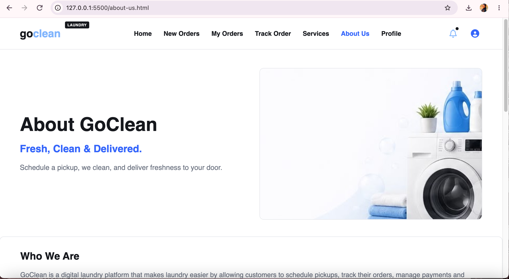

# GoClean — Agile Team Charter

## 1. Project Vision

GoClean is a laundry pickup and delivery service designed to make laundry more convenient for university students and busy township residents. The service offers laundry solutions that include washing, drying, folding and delivery, helping customers save time and enjoy greater convenience.

The GoClean project combines a service concept with a digital application that allows users to explore laundry services and interact with the platform. The application provides a clear and accessible user experience through pages such as Home, About Us, Login and Services.

Our vision was to develop a practical laundry service solution supported by a functional, tested digital application. By combining customer-focused design with Agile project management, our team worked towards delivering a completed project that demonstrates how technology can support an everyday service.

## 2. Project Objectives

The main objectives of the GoClean project were to:

- Develop a practical laundry pickup and delivery service concept.
- Identify the target customers and understand their laundry needs.
- Design and develop a digital application to support the GoClean service.
- Provide an accessible interface for users to explore laundry services and interact with the application.
- Implement the project's planned features, including account access and laundry service information.
- Apply Agile principles to organise requirements, prioritise features and structure development work.
- Break larger requirements into manageable tasks using user stories and task lists.
- Organise project features into product and sprint backlogs.
- Use Trello to coordinate tasks, monitor progress and support team collaboration.
- Test the completed application and review its functionality.
- Document project decisions, achievements, challenges and lessons learned.

These objectives guided the team throughout the project, connecting the service concept, application development and Agile planning activities.

## 3. Project Success Criteria

The success of GoClean was based on delivering a completed digital application that supports the project objectives and provides a clear user experience.

The project success criteria included:

- Developing an application interface that communicates the GoClean service.
- Presenting laundry services and their starting prices clearly.
- Providing the relevant application features planned for the project.
- Testing the application to check that its functionality works as intended.
- Organising requirements and tasks through user stories, the product backlog and sprint backlog.
- Using Trello to coordinate work and record task progress.
- Working collaboratively towards the shared project objectives.
- Preparing project documentation and supporting evidence for the e-portfolio.

The completed project brought together application development, Agile planning and teamwork to demonstrate the team's ability to develop and present a digital solution.

## 4. Team Members

Our team consists of:

- Thandeka Chantal Malande
- Oratilwe Catherine Komane
- Solomon Elias Machaule
- Nomhle Njengele
- Lerato Nadine Letsoele

Our team worked towards shared project objectives by exchanging ideas, discussing requirements, responding to feedback and organising tasks through Trello.

Each team member contributed to the collaborative project process, while communication and coordination helped the team maintain a shared understanding of the project's direction and priorities.

This experience demonstrated the importance of teamwork, accountability, cooperation and effective communication when completing a group software development project.

## 5. Project Scope

The GoClean project focused on developing a laundry pickup and delivery service concept supported by a digital application.

The service concept includes:

- Collection of customers' laundry.
- Washing and drying services.
- Folding clean laundry.
- Delivery of completed laundry to customers.

The digital application covers the customer-facing experience and the features developed for the project, including:

- Welcome and landing screen.
- Customer registration and login.
- Home page.
- Laundry service information.
- Laundry order booking and confirmation.
- Order tracking and order history.
- User profile and settings.
- Notifications.
- Driver assignment.
- Payment functionality.

The application interface includes Home, About Us, Login and Services pages. The Services page presents laundry options and starting prices, while the other interfaces help communicate the GoClean brand and support the intended customer journey.

The project scope was organised through user stories, the product backlog and sprint lists on Trello. This allowed the team to divide requirements into smaller tasks, establish priorities and coordinate development activities.

By combining the service concept, application features and Agile documentation, the project delivered a digital solution aligned with the team's objectives.

## 6. Communication and Collaboration

Communication and collaboration were important throughout the GoClean project. Team members shared ideas, discussed requirements, considered feedback and worked towards completing the agreed project objectives.

Trello served as a shared project management tool for organising product backlog items, dividing features into subtasks and arranging work into sprint lists. This helped the team maintain visibility of the project structure and coordinate tasks.

The team also learned the importance of being adaptable and considering different perspectives when making decisions. Effective collaboration supported the process of refining the project idea, organising requirements and working towards the completed application.

Through this experience, I learned that successful teamwork involves more than dividing tasks. It requires communication, cooperation, accountability and a shared commitment to achieving the project goals.

## 7. Project Direction and Decision-Making

Our team initially considered developing a digital public healthcare clinic appointment and patient management system. Following lecturer feedback about the feasibility and complexity of the original idea, we changed our project direction to GoClean.

The team reconsidered the original concept and selected a laundry pickup and delivery service that could be developed around a more focused set of customer needs and application features.

This decision helped establish a clearer project vision and provided a practical direction for the team's development work. The new concept also allowed us to explore how a digital application could support a familiar everyday service.

The experience taught me the importance of responding constructively to feedback, evaluating different ideas and making decisions that support the project's objectives.

It also demonstrated how adapting a project direction can help a team establish clearer requirements, organise its work and move forward with a shared vision.

## 8. Task Organisation and Progress

Our team used Trello to organise the product backlog, manage sprint lists and divide features into smaller tasks. This supported the planning and coordination of work throughout the project.

One example is the Login Page card. Its checklist contains five completed subtasks relating to screen design, secure credential storage, the login API, error handling and documentation. The card displays 100% checklist completion and provides a record of the team's task organisation and progress.

The team also used application screenshots to document the completed interface. The Login page displays email and password fields, while the Services page presents the available laundry service categories and their starting prices.

Together, the Trello records and application screenshots provide evidence of the project's planning process and the application developed by the team.

Through this process, I learned how dividing features into manageable tasks supports organisation, accountability and progress monitoring. I also developed a better understanding of how Agile tools connect requirements, development activities and project outcomes.

## 9. Challenges and Lessons Learned

One of the main challenges was selecting a project concept that aligned with the team's available time, skills and resources. The original healthcare idea required reconsideration because of its complexity, leading the team to explore the GoClean concept.

This experience taught me that project planning requires flexibility and that constructive feedback can help a team make informed decisions about the direction of its work.

Another important lesson was the value of breaking a project into manageable tasks. The product backlog helped organise the required features, while the sprint backlog grouped work into stages. This made it easier to understand the project's priorities and coordinate development activities.

The project also strengthened my understanding of prioritisation. Features such as account access, laundry service information and booking contribute to the customer experience, while supporting features help provide a more complete application.

Using Trello helped me understand how project management tools can support teamwork and task tracking. The combination of task checklists, planning documents and application screenshots also demonstrated the value of keeping project evidence organised.

Overall, the project improved my understanding of feasibility, adaptability, task management and the practical application of Agile principles in software development.

## 10. Personal Reflection

Through the GoClean project, I developed a better understanding of how Agile planning, teamwork and software development work together to deliver a completed application.

The change from the healthcare management concept to GoClean taught me to be open to feedback and willing to reconsider an initial idea. I learned that project decisions should be guided by the project's objectives, customer needs and the team's ability to develop a suitable solution.

Working with user stories, the product backlog and the sprint backlog helped me understand how requirements can be organised into smaller, manageable tasks. Trello also gave the team a shared space to arrange work and monitor progress.

Developing the application helped me connect these planning activities to a working digital solution. The Home and About Us pages communicate the GoClean concept, the Login page provides the account-access interface, and the Services page presents the laundry options and their starting prices.

Testing the completed application reinforced the importance of checking functionality and ensuring that the solution works as intended. It also helped me appreciate the relationship between planning, implementation and the final product.

If I were working on a similar project in the future, I would continue using structured backlogs, clear task allocation and regular progress updates. I would also maintain organised project records and encourage consistent communication among team members.

Overall, GoClean strengthened my skills in Agile planning, teamwork, problem-solving and software development. Completing the project helped me understand how a team can turn an idea into a digital solution through collaboration, structured planning and practical implementation.

## 11. Supporting Evidence

The following evidence demonstrates the GoClean concept, target market, application design, task organisation and completed interface.

### Evidence 1: Target Market

The target-market material identifies the intended customers for GoClean and illustrates the needs that influenced the service concept. It supports the team's decision to focus on convenient laundry services for students and busy residents.

### Evidence 2: GoClean Wireframes

The wireframes illustrate the application's planned screens and customer journey. They show how the team translated the project requirements into a visual design for the GoClean platform.

### Evidence 3: Trello Board

The Trello board demonstrates how the team organised product backlog items and sprint lists. It provides evidence of the Agile planning structure used to coordinate project tasks.

### Evidence 4: Login Page Tasks

The Login Page card displays five completed subtasks and a 100% checklist. This demonstrates how the team divided the login feature into smaller tasks and recorded their completion through Trello.

### Evidence 5: GoClean About Us Page

The About Us page introduces the GoClean brand and communicates the laundry pickup and delivery service concept. The tagline, "Fresh, Clean & Delivered," reinforces the project's focus on convenience and the intended customer experience.

## 12. Conclusion

The GoClean project provided valuable experience in applying Agile principles to the development of a practical digital solution. Through project planning, backlog management, sprint organisation and collaboration, the team worked towards delivering a completed application.

The project strengthened my understanding of user stories, feature prioritisation, task organisation and the importance of communication throughout software development.

Overall, GoClean demonstrated how a team can respond to feedback, organise requirements, collaborate effectively and apply Agile practices to turn an initial idea into a completed digital project.
