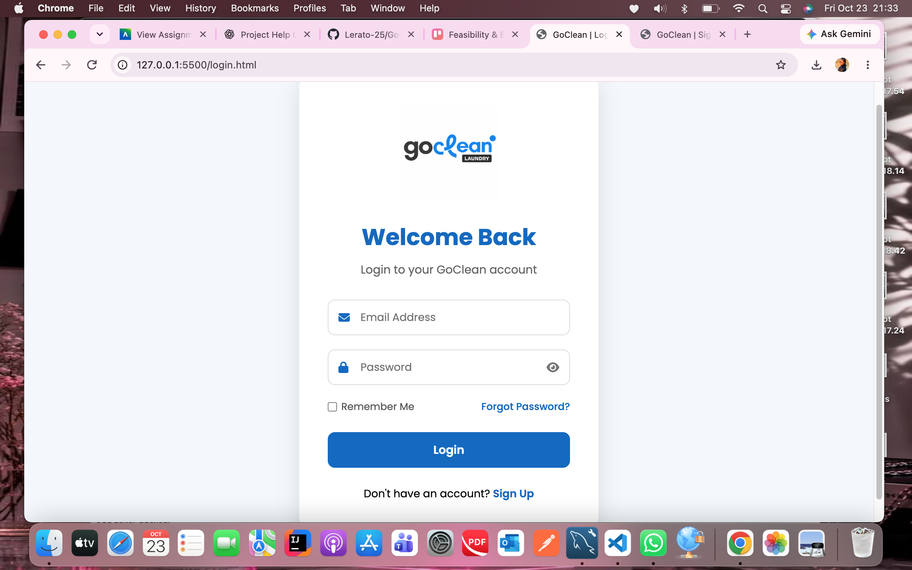
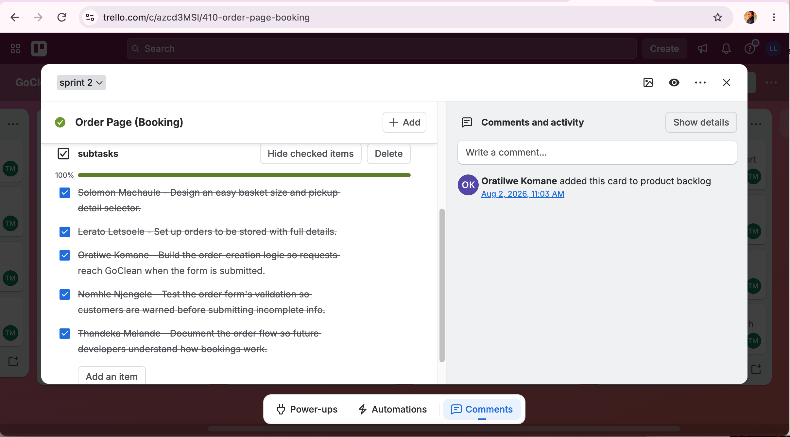
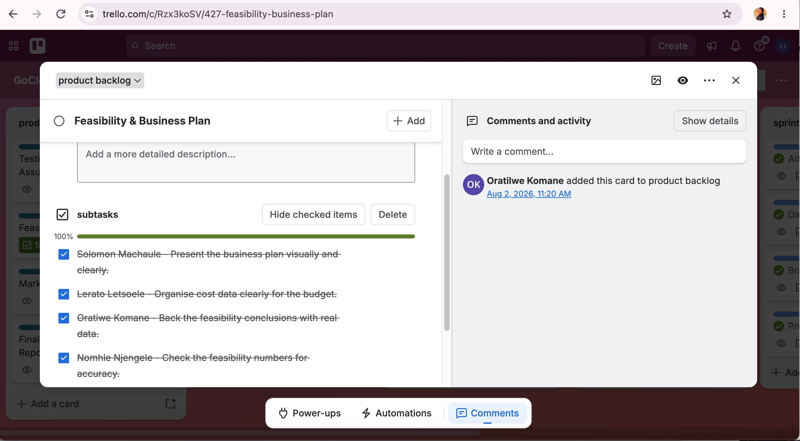

# GoClean Sprint Backlog

## 1. Introduction

A sprint backlog is a collection of product backlog items and tasks organised around a sprint goal. It helps an Agile team structure its work, coordinate responsibilities and monitor progress towards the intended outcomes.

GoClean is a laundry pickup and delivery application designed to provide convenient and affordable laundry services to university students and busy residents. The team used Trello to organise the product backlog, sprint lists and individual task cards throughout the project.

The GoClean Trello board contains a product backlog and sprint lists from Sprint 1 through Sprint 16. For this portfolio, three selected sprint groupings are presented to demonstrate how the team's work was organised around the main customer journey, from accessing the platform to arranging laundry services and managing customer accounts.

## 2. Sprint Goals and Completed Project Work

### Sprint 1: Customer Access and Landing Page

**Sprint goal:** Establish the main entry point to GoClean and organise the features customers need to access the platform.

| Feature | Tasks and activities |
|---|---|
| Welcome/Landing Screen | Design the welcome screen and introduce the GoClean service. |
| Home Page | Organise the main navigation and display key service information. |
| Registration Page | Design the registration form and identify the information required to create an account. |
| Login Page | Design the login interface, provide credential fields and include appropriate login controls and feedback. |

**Progress evidence**

The Login Page card on the Trello board contains five subtasks marked complete. This recorded progress demonstrates how the team divided the login feature into smaller activities and used a checklist to monitor completion.

The login interface is also included in the portfolio as evidence of the application's user interface.

### Sprint 2: Laundry Orders and Tracking

**Sprint goal:** Organise and deliver the main features associated with requesting laundry collection and accessing order information.

| Feature | Tasks and activities |
|---|---|
| Order Page (Booking) | Organise the booking interface and the information customers provide when requesting laundry collection. |
| Order Confirmation | Present confirmation and relevant information after an order is submitted. |
| Order Tracking | Provide customers with information about their order progress. |
| Order History | Organise the display of customers' previous orders. |

These features represent an important part of the GoClean customer journey. The booking process allows customers to arrange laundry services, while order confirmation, tracking and history support access to relevant order information.

**Progress evidence**

The Order Page (Booking) Trello card records five completed subtasks and 100% checklist progress. The card also shows team members assigned to the work, providing evidence of task allocation, collaboration and recorded progress.

The booking task card demonstrates how a larger feature was divided into manageable activities and tracked through Trello.

### Sprint 3: Account Management and Supporting Features

**Sprint goal:** Organise the account-management and supporting functionality associated with the wider GoClean service.

| Feature | Tasks and activities |
|---|---|
| User Profile and Settings | Organise the customer information and account settings available to users. |
| Notifications | Identify and present relevant updates about bookings and order progress. |
| Driver Assignment | Organise the allocation of pickup and delivery tasks to drivers. |
| Payments | Address payment functionality associated with laundry services. |

These features complement the main customer journey by addressing account management, communication and service operations. Together, the three sprint groupings provide a structured overview of the key functionality identified for GoClean.

## 3. Task Organisation and Progress Tracking

The team used Trello as a shared workspace to organise features, manage task cards and record progress. Separate sprint lists made the work visible and helped team members review activities associated with different parts of the application.

Breaking features into smaller tasks made the work easier to understand, allocate and monitor. Checklists provided a practical way to record task completion. The Login Page and Order Page (Booking) cards, for example, each contain five subtasks marked complete.

The main task-management practices included:

- Organising features and tasks in Trello.
- Dividing larger features into smaller activities.
- Assigning team members to relevant task cards.
- Recording progress through checklist completion.
- Communicating about responsibilities and related tasks.
- Keeping task organisation aligned with the product backlog.
- Reviewing completed work in relation to the project's objectives.

These practices supported collaboration and helped the team maintain visibility of its work. The Trello board and task cards provide concrete evidence of how the team organised and recorded project activities.

## 4. Teamwork and Agile Learning

Working with sprint groupings helped the team organise GoClean into related areas of functionality. The selected groupings demonstrate the progression from customer access to laundry ordering and then to account management and supporting features.

The task cards also illustrate the value of shared responsibility. By recording assigned team members and checklist progress, Trello provided a common reference point for the work associated with individual features.

The project strengthened my understanding of how sprint goals, task breakdowns and progress records work together within Agile development. It also demonstrated the importance of connecting individual activities to the wider product objectives so that team members can understand how their contributions fit into the completed application.

## 5. Personal Reflection

Working with the GoClean sprint backlog improved my understanding of how Agile development organises a larger project into manageable groups of features and tasks. I learned that sprint goals provide direction, while individual task cards help make the work more specific and easier to coordinate.

The three selected sprint groupings helped me understand how different features contribute to the customer journey. Customer access establishes the starting point, laundry booking supports the main service process, and account management and supporting features contribute to the wider user experience.

Using Trello strengthened my understanding of task organisation and teamwork. The Login Page and Order Page (Booking) cards demonstrated how checklists can be used to divide activities into smaller tasks and record their completion. Seeing team assignments and checklist progress also helped me appreciate the value of a shared workspace when working on a group project.

Completing and testing GoClean allowed me to connect the planning process with the finished application. I gained a clearer understanding of how sprint organisation, task allocation and progress tracking contribute to the development process and support the delivery of a completed project.

Overall, this activity strengthened my knowledge of sprint planning, Agile teamwork, task management and progress tracking. It also taught me the importance of maintaining clear task records and connecting individual activities to the objectives of the application.

## 6. Supporting Evidence

### Evidence 1: Feasibility and Business Plan Task Breakdown

The Feasibility and Business Plan Trello card records a checklist with 100% completion. It demonstrates how a broader project activity was divided into smaller subtasks and how completion was recorded through Trello.

### Evidence 2: Sprint Planning and Task Organisation

The GoClean Trello board provides an overview of the product backlog, sprint lists and task cards used to organise the project.

The board illustrates the team's approach to grouping work, assigning tasks and recording progress. Alongside the task-card screenshots and application interface evidence, it supports the portfolio's explanation of how Agile practices were applied throughout the GoClean project.

### Conclusion

The GoClean sprint backlog demonstrates how the team organised features, structured tasks and recorded progress using Agile practices. The sprint groupings and Trello evidence connect the project's planning activities with the completed application, while the reflection highlights the knowledge and teamwork skills gained through the process.
